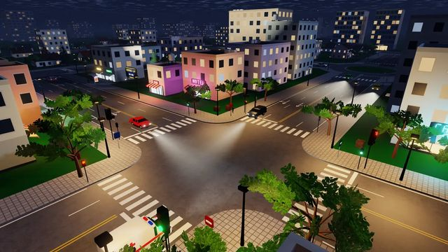
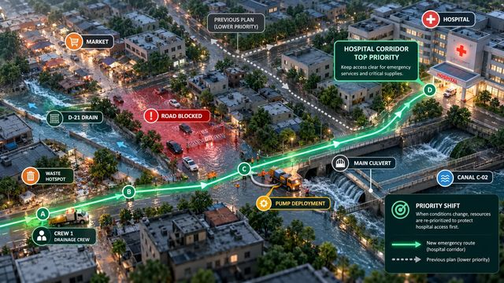
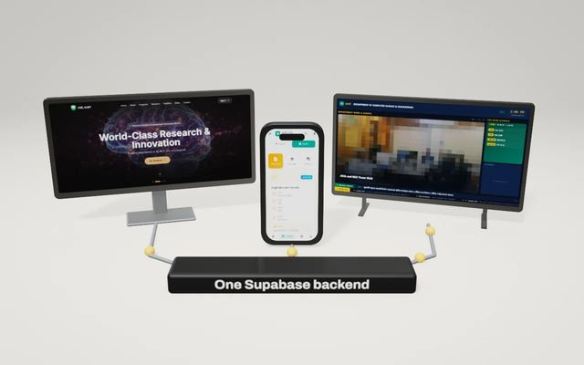
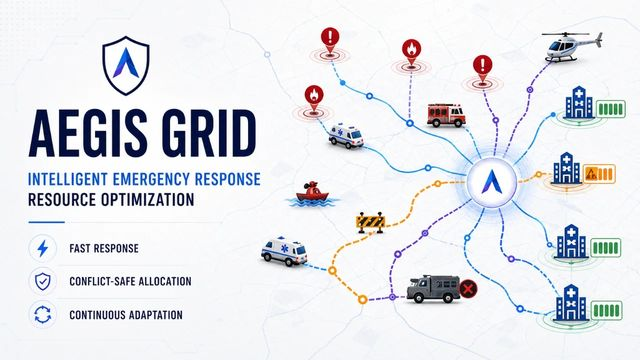
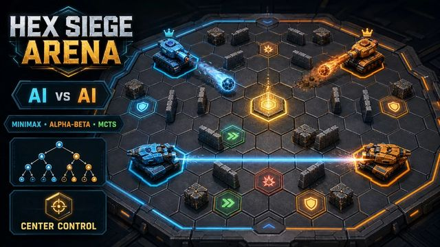
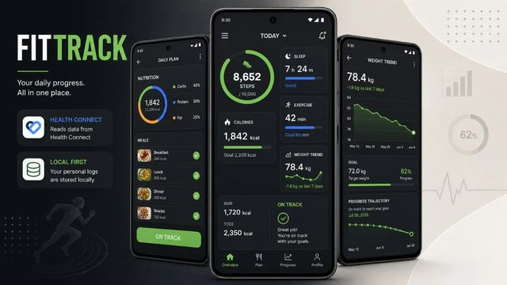

<a href="https://asifjawad.vercel.app/">
  
</a>

<div align="center">


[](https://asifjawad.vercel.app/)
[](https://linkedin.com/in/asif-jawad-592461355)
[](mailto:asifjawadaj15@gmail.com)
[](https://asifjawad.vercel.app/resume.pdf)


</div>

## `0x00` whoami

```bash
$ whoami --verbose
name      : Asif Jawad
role      : software & systems engineer
study     : B.Sc. Computer Science & Engineering, KUET (2023 – present)
based     : Khulna, Bangladesh
builds    : web · android · ios · backend · data · iot
explores  : graphics · ai · security · networks · numerical methods
status    : open to internships, research and engineering work

$ cat philosophy.txt
I like the point where software, data and hardware meet,
and I keep going until the thing actually runs.
```

## `0x01` Systems I built



### 3D Smart City
**`C++` `OpenGL` `GLSL`** &nbsp;·&nbsp; solo

A city simulator with 164 buildings and no imported models. Signals cycle, cars queue without colliding, people cross, the day turns to night and rain falls, with shadow maps and ray-marched reflections, at a steady 72 FPS.

→ [Read the case](https://asifjawad.vercel.app/work/smart-city) · [Source](https://github.com/AsifJawad15/Interactive-3D-Traffic-Intersection-Road-Simulator)

<br clear="right" />



### NagarShield 360
**`Flutter` `Next.js` `Supabase`** &nbsp;·&nbsp; with Abdullah Md. Shahporan

One street, many teams. A city operations prototype where a report moves through verify, assign, evidence and approve, and only counts as solved after the proof is checked. Detection is simulated.

→ [Read the case](https://asifjawad.vercel.app/work/nagarshield-360) · [App](https://github.com/AsifJawad15/NagarShield-360-app) · [Web](https://github.com/AsifJawad15/NagarShield-360-web)

<br clear="left" />



### Taka
**`FastAPI` `PostgreSQL` `RabbitMQ` `React`** &nbsp;·&nbsp; with Abdullah Md. Shahporan

A mobile wallet on a balanced double-entry ledger, built at the PSTU IT Carnival 2026 hackathon. A double tap, a dropped connection or a retry never pays twice, thanks to idempotency keys, escrow and a 10-second undo.

→ [Read the case](https://asifjawad.vercel.app/work/taka) · [Source](https://github.com/abdullahshahporan/money_management_pstu_hackathon)

<br clear="right" />



### Dept Flow
**`Next.js` `Flutter` `Supabase` `FCM`** &nbsp;·&nbsp; with Abdullah Md. Shahporan

KUET CSE automation. One backend feeds a web portal, a mobile app and the TV displays outside the rooms: schedules, geo-attendance, results and notices.

→ [Web](https://github.com/AsifJawad15/KUET-CSE-Automation-Web-Portal) · [App](https://github.com/AsifJawad15/KUET-CSE-Automation-Mobile--App)

<br clear="left" />

<details>
<summary><b>More builds</b>: Aegis Grid, Hex Siege Arena, FitTrack, ELORA</summary>
<br/>



**[Aegis Grid](https://github.com/AsifJawad15/pstu_hackathon)** · `Node.js` `PostGIS` `Kafka` `Docker`<br/>
An emergency response backend that assigns units without conflicts and re-plans when roads close.

<br clear="right" />



**[Hex Siege Arena](https://github.com/AsifJawad15/HexSiegeArena-AI_Game)** · `Godot 4` `GDScript`<br/>
Two AIs fight on 91 hexes with Minimax, Alpha-Beta pruning and Monte Carlo tree search.

<br clear="left" />



**[FitTrack](https://github.com/AsifJawad15/FitTrack)** · `Kotlin` `Jetpack Compose` `Room`<br/>
A local-first Android fitness tracker with Health Connect, nutrition and goal trajectories.

<br clear="right" />


**[ELORA](https://github.com/AsifJawad15/ELORA-ContextAwareE-CommercePlatform)** · `SwiftUI` `Firebase` `MapKit`<br/>
An iOS fashion store with location-aware checkout and multi-currency prices.

<br clear="left" />
</details>

## `0x02` The Arena

> Six fields, opened one at a time. On the [portfolio](https://asifjawad.vercel.app/) each one is a live drawing you can step into.

<details>
<summary><code>net</code>&nbsp; <b>Networks & security</b>: routing, queues, attacks</summary>

- [Computer networks](https://github.com/AsifJawad15/Computer_Network): VLSM, DHCP, DNS, RIP, OSPF, VLANs, NAT/PAT, GRE over IPsec
- [DoS and DDoS simulation](https://github.com/AsifJawad15/Security-Controlled-DoS-and-DDos-Simulation): load shedding on localhost, who gets served when the queue is full
</details>

<details>
<summary><code>dsa</code>&nbsp; <b>Data structures & algorithms</b>: sorting, graphs, compilers, game search</summary>

- [DSA in C++](https://github.com/AsifJawad15/DSA): five sorts, Dijkstra, Bellman-Ford, negative cycles
- [Compiler](https://github.com/AsifJawad15/CSE3212-Compiler_Project): Flex, Bison, three-address code, constant folding
- [Hex Siege Arena](https://github.com/AsifJawad15/HexSiegeArena-AI_Game): Minimax, Alpha-Beta, Monte Carlo tree search
</details>

<details>
<summary><code>num</code>&nbsp; <b>Numerical methods</b>: f(x) → 0</summary>

- [Numerical analysis in C++](https://github.com/AsifJawad15/Neumerical-Analysis): bisection, false position, Newton-Raphson, secant
- Jacobi, Gauss-Seidel, Gauss-Jordan and LU factorisation
- Least squares fitting, Newton interpolation, Simpson's rules, Runge-Kutta 4
</details>

<details>
<summary><code>ai</code>&nbsp; <b>Intelligence</b>: language, optimisation, data</summary>

- [Smart FAQ retrieval](https://github.com/AsifJawad15/NLP-Based-Smart-FAQ-Retrieval): TF-IDF, Word2Vec from scratch, Sentence-BERT on 215 KUET FAQs
- [Bee colony vs genetic algorithm](https://github.com/AsifJawad15/ML_Meta_Heurestic): meta-heuristics on the Ackley function
- [What shapes student CGPA?](https://github.com/AsifJawad15/Student-Performance-analysis-dataset): 1,108 survey responses from four universities
</details>

<details>
<summary><code>gfx</code>&nbsp; <b>Graphics & vision</b>: light to pixels, pixels to meaning</summary>

- [3D Smart City](https://github.com/AsifJawad15/Interactive-3D-Traffic-Intersection-Road-Simulator): C++ and OpenGL, shadows, rain, ray-marched reflections
- [Reverse ray tracing](https://github.com/AsifJawad15/Reverse_Ray_Tracing): light first, then the eye
- [Image processing](https://github.com/AsifJawad15/Image_Processing): 21 filters and convolutions written from scratch
</details>

<details>
<summary><code>sys</code>&nbsp; <b>Systems & robotics</b>: logic, sensors, motors</summary>

- [CPU architecture](https://github.com/AsifJawad15/CPU_architecture): a mini CPU with a custom ALU in Logisim
- [Smart door lock](https://github.com/AsifJawad15/smart_door_lock): ESP32, RFID and an expiring one-time PIN
- [IoT WareFlow](https://github.com/SheikhGalib/iot-wareflow): a robot car that carries and scans inventory (team)
</details>

## `0x03` Stack, layer by layer

| Layer | Tools |
|:--|:--|
| `L1` **Languages** |  |
| `L2` **Interfaces**<br/><sub>web and mobile</sub> | <br/><sub>Jetpack Compose · SwiftUI · MapKit</sub> |
| `L3` **Services**<br/><sub>APIs and messaging</sub> | <br/><sub>REST · idempotency keys · double-entry ledgers</sub> |
| `L4` **Data** | <br/><sub>PostGIS · Room · row level security</sub> |
| `L5` **Intelligence & visual computing** | <br/><sub>OpenGL · GLSL · NumPy · Jupyter · WEKA · Sentence-BERT</sub> |
| `L6` **Systems, networks & hardware** | <br/><sub>Cisco Packet Tracer · ESP32 · RFID · Logisim · Flex & Bison</sub> |
| `L7` **Workflow** |  |

## `0x04` Log

```diff
+ 2026  National Hackathon, PSTU IT Carnival  built Taka, a wallet on a double-entry ledger
+ 2025  Google UX Design Foundations         certificate
+ 2024  Google Foundations of Cybersecurity  certificate
+ 2024  IBM Data Analysis with Python        certificate
+ 2023  Intra KUET Programming Contest       competitive programming
! now   research paper in preparation        details stay private until publication
```

## `0x05` Commit graph

<div align="center">
  <picture>
    <source media="(prefers-color-scheme: dark)" srcset="https://raw.githubusercontent.com/AsifJawad15/AsifJawad15/output/github-contribution-grid-snake-dark.svg" />
    <source media="(prefers-color-scheme: light)" srcset="https://raw.githubusercontent.com/AsifJawad15/AsifJawad15/output/github-contribution-grid-snake.svg" />
    
  </picture>
</div>

## `0xFF` Connect

<div align="center">

Have a system worth building? &nbsp;[asifjawadaj15@gmail.com](mailto:asifjawadaj15@gmail.com) · [LinkedIn](https://linkedin.com/in/asif-jawad-592461355) · [asifjawad.vercel.app](https://asifjawad.vercel.app/)

</div>


