<a href="https://asifjawad.vercel.app/">
  
</a>

<div align="center">


[](https://asifjawad.vercel.app/)
[](https://linkedin.com/in/asif-jawad-592461355)
[](mailto:asifjawadaj15@gmail.com)
[](https://asifjawad.vercel.app/resume.pdf)


</div>

## `0x00` whoami

```bash
$ whoami --verbose
name      : Asif Jawad
role      : software & systems engineer
study     : B.Sc. Computer Science & Engineering, KUET (2023 – present)
based     : Khulna, Bangladesh
builds    : web · android · ios · backend · data · iot
explores  : graphics · ai · security · networks · numerical methods
status    : open to internships, research and engineering work

$ cat philosophy.txt
I like the point where software, data and hardware meet,
and I keep going until the thing actually runs.
```

## `0x01` The Arena

> Six fields, each with the labs and repositories behind them. On the [portfolio](https://asifjawad.vercel.app/) every field is a live drawing you can step into.

<table>
<tr>
<td width="50%" valign="top">

**Networks & security** &nbsp;`routing` `queues`

- [Computer networks](https://github.com/AsifJawad15/Computer_Network): VLSM, DHCP, DNS, RIP, OSPF, VLANs, NAT/PAT, GRE over IPsec
- [DoS and DDoS simulation](https://github.com/AsifJawad15/Security-Controlled-DoS-and-DDos-Simulation): load shedding on localhost, who gets served when the queue is full

</td>
<td width="50%" valign="top">

**Data structures & algorithms** &nbsp;`O(n log n)`

- [DSA in C++](https://github.com/AsifJawad15/DSA): five sorts, Dijkstra, Bellman-Ford, negative cycles
- [Compiler](https://github.com/AsifJawad15/CSE3212-Compiler_Project): Flex, Bison, three-address code, constant folding
- [Hex Siege Arena](https://github.com/AsifJawad15/HexSiegeArena-AI_Game): Minimax, Alpha-Beta, Monte Carlo tree search

</td>
</tr>
<tr>
<td valign="top">

**Numerical methods** &nbsp;`f(x) → 0`

- [Numerical analysis in C++](https://github.com/AsifJawad15/Neumerical-Analysis): bisection, false position, Newton-Raphson, secant
- Jacobi, Gauss-Seidel, Gauss-Jordan, LU factorisation
- Least squares fitting, Newton interpolation, Simpson's rules, Runge-Kutta 4

</td>
<td valign="top">

**Intelligence** &nbsp;`train → test`

- [Smart FAQ retrieval](https://github.com/AsifJawad15/NLP-Based-Smart-FAQ-Retrieval): TF-IDF, Word2Vec from scratch, Sentence-BERT on 215 KUET FAQs
- [Bee colony vs genetic algorithm](https://github.com/AsifJawad15/ML_Meta_Heurestic): meta-heuristics on the Ackley function
- [What shapes student CGPA?](https://github.com/AsifJawad15/Student-Performance-analysis-dataset): 1,108 survey responses, four universities

</td>
</tr>
<tr>
<td valign="top">

**Graphics & vision** &nbsp;`light → pixels`

- [3D Smart City](https://github.com/AsifJawad15/Interactive-3D-Traffic-Intersection-Road-Simulator): C++ and OpenGL, shadows, rain, ray-marched reflections
- [Reverse ray tracing](https://github.com/AsifJawad15/Reverse_Ray_Tracing): light first, then the eye
- [Image processing](https://github.com/AsifJawad15/Image_Processing): 21 filters and convolutions written from scratch

</td>
<td valign="top">

**Systems & robotics** &nbsp;`logic → motors`

- [CPU architecture](https://github.com/AsifJawad15/CPU_architecture): a mini CPU with a custom ALU in Logisim
- [Smart door lock](https://github.com/AsifJawad15/smart_door_lock): ESP32, RFID and an expiring one-time PIN
- [IoT WareFlow](https://github.com/SheikhGalib/iot-wareflow): a robot car that carries and scans inventory (team)

</td>
</tr>
</table>

## `0x02` Selected work

| | System | What it does | Built with |
|:--:|:--|:--|:--|
| `01` | **[3D Smart City](https://asifjawad.vercel.app/work/smart-city)** | City simulator: signals, traffic, people, day and night, rain, 72 FPS | C++ · OpenGL · GLSL |
| `02` | **[NagarShield 360](https://asifjawad.vercel.app/work/nagarshield-360)** | City operations prototype where a report only counts as solved after proof is checked | Flutter · Next.js · Supabase |
| `03` | **[Taka](https://asifjawad.vercel.app/work/taka)** | Mobile wallet on a double-entry ledger: a retry or double tap never pays twice | FastAPI · PostgreSQL · RabbitMQ · React |
| `04` | **Dept Flow** ([web](https://github.com/AsifJawad15/KUET-CSE-Automation-Web-Portal), [app](https://github.com/AsifJawad15/KUET-CSE-Automation-Mobile--App)) | KUET CSE automation: schedules, geo-attendance, notices and TV displays from one database | Next.js · Flutter · Supabase · FCM |
| `05` | **[Aegis Grid](https://github.com/AsifJawad15/pstu_hackathon)** | Emergency response backend that assigns units and re-plans when roads close | Node.js · PostGIS · Kafka · Docker |
| `06` | **[FitTrack](https://github.com/AsifJawad15/FitTrack)** | Local-first Android fitness tracker with Health Connect | Kotlin · Jetpack Compose · Room |
| `07` | **[ELORA](https://github.com/AsifJawad15/ELORA-ContextAwareE-CommercePlatform)** | iOS store with location-aware checkout and multi-currency prices | SwiftUI · Firebase · MapKit |

<sub>NagarShield 360, Taka and Dept Flow are built with Abdullah Md. Shahporan.</sub>

## `0x03` Stack

<div align="center">

<br/>
<br/>
<br/>


<sub>also: OpenGL · GLSL · NumPy · Jupyter · WEKA · Cisco Packet Tracer · ESP32 · Logisim · Flex & Bison</sub>

</div>

## `0x04` Log

```diff
+ 2026  PSTU IT Carnival hackathon        built Taka, a wallet on a double-entry ledger
+ 2025  Google UX Design Foundations      certificate
+ 2024  Google Foundations of Cybersecurity  certificate
+ 2024  IBM Data Analysis with Python     certificate
+ 2023  Intra KUET Programming Contest    competitive programming
! now   research paper in preparation      details stay private until publication
```

## `0x05` Commit graph

<div align="center">
  <picture>
    <source media="(prefers-color-scheme: dark)" srcset="https://raw.githubusercontent.com/AsifJawad15/AsifJawad15/output/github-contribution-grid-snake-dark.svg" />
    <source media="(prefers-color-scheme: light)" srcset="https://raw.githubusercontent.com/AsifJawad15/AsifJawad15/output/github-contribution-grid-snake.svg" />
    
  </picture>
</div>

## `0xFF` Connect

<div align="center">

Have a system worth building? &nbsp;[asifjawadaj15@gmail.com](mailto:asifjawadaj15@gmail.com) · [LinkedIn](https://linkedin.com/in/asif-jawad-592461355) · [asifjawad.vercel.app](https://asifjawad.vercel.app/)

</div>


